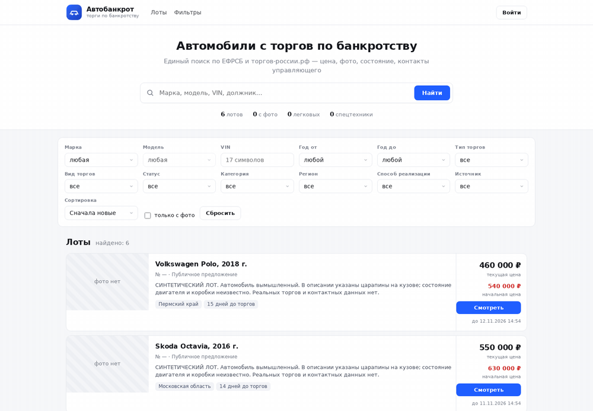
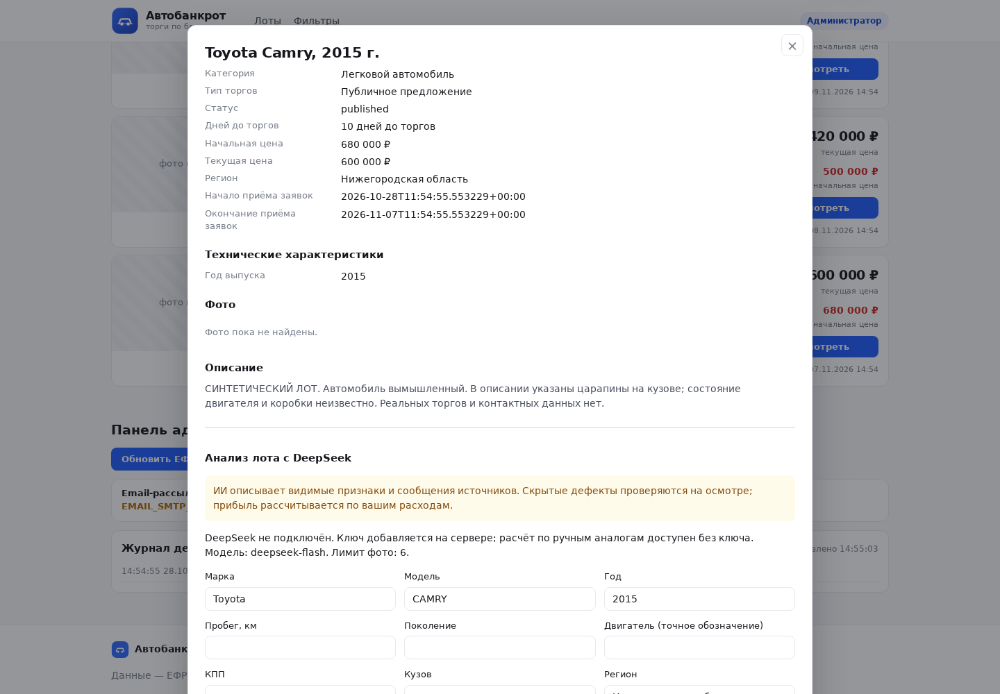
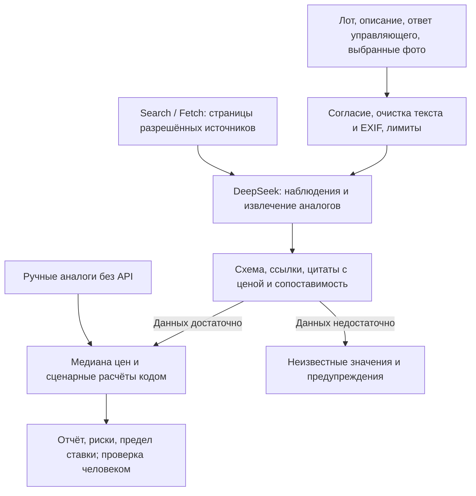

# Автомобильные торги (`car_lot_pilot`) — агрегатор автомобильных торгов

Сервис для сбора сведений об автомобильных торгах и автоматического дополнения карточек лотов.

**Главная особенность — автоматический запрос информации у управляющих:** сервис отправляет письма с просьбой сообщить техническое состояние автомобиля и прислать фотографии, получает ответы по почте и добавляет извлечённые сведения и изображения в карточку лота.

**Статус:** исследовательский прототип, исходный код открыт. Почтовый цикл реализован в коде; доставка реальных писем проверяется после настройки ящика. Добавлен модуль анализа лота через DeepSeek API: наблюдения по описанию и фото, проверка источников, сценарные расчёты и история. 28.10.2026 выполнен сквозной запрос с действующим API на синтетическом лоте и тестовом изображении. Точность оценки реального автомобиля и полнота рыночных источников этим не подтверждаются.

Автор — [Евгений Смирнов](https://github.com/trollpom). Прикладной проект разработки с помощью ИИ и AI coding tools.

**Настоящий запрос DeepSeek:** [воспроизводимый сценарий на 60–90 секунд и подтверждённые ограничения](demo/README.md). Опубликованной видеозаписи живого запроса нет; GIF ниже показывает интерфейс без обращения к LLM. Сквозной тест от 28.10.2026 указан выше как историческая проверка; повторный платный запрос для этой правки не выполнялся.


## Демонстрация для жюри

Название в приложении — **«Автомобильные торги»**, репозиторий — `car_lot_pilot`.

Реальный интерфейс на отдельной локальной SQLite-базе. Автомобили, описания и суммы вымышлены; фото настоящих автомобилей и контактные данные не используются. Почта, сбор торгов и платные запросы отключены. Снимки обновлены 29.10.2026. Тестовая таблица в карточке не является фотографией автомобиля.



GIF — последовательность двух реальных экранов: каталог → карточка. Это не запись запроса к LLM.

| Каталог | Карточка лота |
| --- | --- |
|  |  |

[Изолированный демозапуск, сценарий живого запроса и подтверждённые ограничения](demo/README.md).

[Исторический кадр офлайн-расчёта от 28.10.2026](docs/screenshots/archive/2026-10-28-calculation.png) сохранён отдельно и не входит в новую галерею.

В демонстрации расчёт выполняется существующим API без ключа. Ручные аналоги — учебные входные данные, а не найденные рыночные объявления. Результат не подтверждает выгоду реальных торгов.

## Где работает ИИ



Наблюдения по фото не являются диагностикой скрытых неисправностей. Вероятность победы остаётся неизвестной без истории ставок. Автоматический почтовый цикл запросов управляющим и дополнение карточек сохранены; демонстрация не отправляет письма.


## Реализовано в коде

- Парсеры сообщений ЕФРСБ и каталога автомобильных торгов, включая офлайн-разбор сохранённых HTML.
- Извлечение VIN, цены, региона и других полей; SQLite-хранилище и история цен.
- Веб-каталог с фильтрами, карточками и фотографиями.
- Поиск изображений, загрузка, проверка и создание превью. Принадлежность найденного фото конкретному лоту проверяется вручную.
- Автоматический почтовый цикл: запрос управляющему по SMTP → получение ответа по IMAP → извлечение состояния и фотографий → дополнение карточки лота.
- Локальные административные операции и журнал событий.
- Анализ выбранного лота по запросу: наблюдения по описанию, ответу управляющего и подтверждённым пользователем фото через DeepSeek; поиск объявлений-аналогов через Search/Fetch API.
- Проверка цитат с ценами, фильтрация и удаление повторов аналогов; средняя, медиана и квартили цен предложений при наличии минимум трёх подходящих наблюдений.
- Три сценария прибыли, ROI и предел ставки с учётом заданных расходов. Расчёт по ручным аналогам доступен без ключа. История AI-отчётов доступна администратору.

Доступность сайтов и корректность данных требуют живых проверок. Гарантии полноты, выгодности покупки и юридической чистоты автомобиля не заявляются.

## Главная особенность: запрос управляющему → дополненная карточка

### Как работает почтовый цикл

1. **Подбор лотов.** Фоновая задача выбирает из очереди лоты без фотографий с известным контактным email управляющего.
2. **Запрос информации.** Сервис формирует письмо с указанием автомобиля и запросом сведений о техническом состоянии и фотографий. Отправка выполняется через настроенный SMTP. В карточке сохраняются статус и время отправки.
3. **Получение ответа.** Отдельная фоновая задача проверяет почту по IMAP. Код отсеивает собственные письма, типовые автоответы и уведомления о недоставке; обработанные сообщения учитываются по Message-ID.
4. **Привязка к лоту и разбор.** Для сопоставления используются адрес отправителя, почтовые заголовки ответа, номер лота и VIN. Из текста извлекаются сведения о состоянии; из поддерживаемых вложений — фотографии. Поддержана обработка изображений, текста и встроенных изображений PDF, а также вложенных файлов ZIP.
5. **Интеграция в сервис.** Извлечённые сведения сохраняются в SQLite, фотографии — в хранилище изображений с превью. Карточка показывает раздел «Состояние автомобиля», обновлённую галерею и статус «Получен ответ». Действия отражаются в журнале.

При наличии сведений в ответе карточка дополняется общим описанием, пробегом, состоянием двигателя, кузова и салона, дефектами, информацией о документах и возможности осмотра. Исходный текст ответа сохраняется вместе с результатом разбора.

### Настройка рабочего режима

Механизм автоматической отправки и приёма ответов сохранён. Для его включения заполните **локальный** `.env`:

- SMTP: `EMAIL_SMTP_HOST`, `EMAIL_SMTP_PORT`, `EMAIL_SMTP_USER`, `EMAIL_SMTP_PASSWORD`.
- Отправитель и подпись: `EMAIL_FROM`, `EMAIL_FROM_NAME`, `EMAIL_SIGNATURE`; тема — `EMAIL_SUBJECT`.
- IMAP: `EMAIL_IMAP_HOST`, `EMAIL_IMAP_PORT`, `EMAIL_IMAP_USER`, `EMAIL_IMAP_PASSWORD`.

Затем включите оба фоновых цикла и перезапустите приложение:

```dotenv
EMAIL_AUTO_SEND=1
EMAIL_AUTO_CHECK=1
```

Они запускаются вместе с `python scripts/serve.py`. Для SMTP и IMAP используйте настройки своего почтового сервиса и пароль приложения, если он требуется провайдером.

| Параметр | Назначение | Пример настройки |
| --- | --- | --- |
| `EMAIL_AUTO_SEND_DELAY_MIN` | Задержка первой отправки после запуска | `2` минуты |
| `EMAIL_SEND_INTERVAL_MIN` | Интервал обработки очереди запросов | `60` минут |
| `EMAIL_CHECK_INTERVAL_MIN` | Интервал проверки ответов | `15` минут |
| `EMAIL_BATCH_SIZE` | Размер очередной порции новых запросов | `20` лотов |
| `EMAIL_SEND_DAILY_LIMIT` | Настройка дневного лимита отправки | `80` |
| `EMAIL_WARMUP_START`, `EMAIL_WARMUP_STEP` | Начальный лимит и его увеличение по дням | `20`, `10` |
| `EMAIL_FOLLOW_UP_DAYS` | Срок до напоминания при отсутствии ответа | `7` дней |

В коде также предусмотрен второй почтовый ящик для повторной отправки недоставленных запросов; он подключается отдельно через `EMAIL2_*`. Необходимые параметры перечислены в `.env.example`.

Для чистой установки и демонстрации в примере оставлено `EMAIL_AUTO_SEND=0`. В рабочем `.env` значение `1` включает существующий механизм; при отсутствии настроенного SMTP отправка пропускается.

### Границы автоматической обработки

Сопоставление ответа с лотом и извлечение сведений выполняются эвристически. Если у одного управляющего несколько лотов, привязка может ошибиться: проверяйте выбранную карточку и исходный текст. Разбор не является технической экспертизой автомобиля и не гарантирует извлечение всех сведений. Живой почтовый цикл зависит от доступа к ящику и ответов управляющих.

## Технологии

`Python 3.10+` · `FastAPI` · `Pydantic 2` · `SQLite` · `Requests` · `DeepSeek API` · `Playwright` · `Pillow` · `PyMuPDF` · `JavaScript`

## Анализ лота и экономика участия

Войдите администратором, откройте карточку и раздел **«Анализ лота с DeepSeek»**. Уточните автомобиль, плановую ставку и расходы. Выберите проверенные фотографии, подтвердите их принадлежность лоту и передачу данных провайдеру. Анализ запускается кнопкой; сбор лотов и получение писем не вызывают платные запросы автоматически.

Для расчёта без API добавьте минимум три разных объявления с полными рублёвыми ценами и датами наблюдения, задайте расходы и нажмите **«Рассчитать без API»**. Пустой расход означает «неизвестно», а `0` — явно заданное допущение. Ручные аналоги помечаются как введённые пользователем, а не проверенные загрузчиком.

Ключ хранится **в локальном `.env` на том компьютере, где запускается сервер**. После установки зависимостей настройте его скрытым вводом:

```bash
python scripts/configure_deepseek.py
python scripts/configure_deepseek.py --check
```

Команда сохраняет только ключ и отсутствующую настройку модели, не меняет параметры почты и проверяет доступ через `/models` без платной генерации. На Unix `.env` получает права `0600`; на Windows защитите доступ к файлу средствами своей учётной записи. Приоритет переменных окружения над `.env` сохраняется. Затем задайте собственный `ADMIN_PASSWORD` в `.env` и перезапустите сервис. Для текущего адаптера указана модель с vision `deepseek-flash`.

Ключи и временные файлы настройки исключены из Git. Исходники GitHub не переносят секрет на другой компьютер: после клонирования настройку нужно выполнить на нём отдельно. Не помещайте ключ в README, JavaScript, аргументы командной строки или скриншоты. Без ключа доступен ручной калькулятор.

ИИ отделяет сообщения источников, видимые признаки и предположения. Фото не подтверждают исправность скрытых узлов. Рыночный расчёт опирается на **цены предложений**, а не завершённых сделок; процент вероятности победы без проверенной истории ставок не выдаётся. Технические и юридические проверки остаются отдельными действиями.

[Архитектура, формулы, API и ограничения](docs/lot-analysis.md).

## Локальный запуск

```bash
git clone https://github.com/trollpom/car_lot_pilot.git
cd car_lot_pilot
python -m venv .venv
# Windows: .venv\Scripts\activate
# macOS/Linux: source .venv/bin/activate
python -m pip install -r requirements.txt
```

Скопируйте `.env.example` в локальный `.env`. Для изолированной демонстрации задайте:

```dotenv
EFRSB_HOST=127.0.0.1
ADMIN_PASSWORD=
EMAIL_AUTO_SEND=0
EMAIL_AUTO_CHECK=0
TORGI_AUTO_SCRAPE=0
EMAIL2_ENABLED=0
```

Оставьте почтовые реквизиты пустыми. Пустой `ADMIN_PASSWORD` запрещает административный вход; для его проверки задайте собственную длинную случайную строку в `.env`. Общего предустановленного пароля больше нет.

```bash
python scripts/serve.py
```

Интерфейс: http://127.0.0.1:8000/ · API: http://127.0.0.1:8000/api/docs . Пустая база — ожидаемое состояние чистого запуска.

## Проверка без обращения к сайтам

```bash
python -m pip install -r requirements-dev.txt
python -m unittest discover -s tests -v
python -m compileall -q app scripts
node --check app/static/analysis.js
node --check app/static/app.js
```

Тесты анализа создают временную SQLite-базу, отключают фоновые почтовые задачи и сбор, используют имитацию ответов DeepSeek. Проверяются расчёты, свидетельства, фильтры аналогов, доступ, лимиты, повторные запросы и история. Это не проверка реальной доставки писем, live-поиска или точности vision. Node нужен только для необязательной проверки синтаксиса JavaScript.

Для проверки существующего HTML-парсера отдельно подготовьте обезличенные файлы в `data/offline` и выполните `python scripts/run_scraper.py --offline data/offline`.

## Основные модули

| Путь | Назначение |
| --- | --- |
| `app/parser.py`, `app/vehicle.py` | Извлечение и нормализация полей |
| `app/scraper/` | Источники и разбор |
| `app/photos/` | Поиск и обработка изображений |
| `app/db.py` | Хранение лотов и истории |
| `app/api/`, `app/static/` | API и интерфейс |
| `app/analysis/` | Адаптер DeepSeek, свидетельства, аналоги, расчёты, история и лимиты |
| `tests/test_analysis.py` | Изолированные офлайн-проверки модуля анализа и API |
| `scripts/configure_deepseek.py` | Скрытый ввод, безопасная замена серверного ключа и проверка подключения |
| `app/email_worker.py` | Фоновые циклы отправки и приёма ответов |
| `app/emailer.py` | Письма SMTP/IMAP и сопоставление ответов с лотами |
| `app/responder.py` | Извлечение состояния, обработка вложений и сохранение фотографий |

## Ограничения и безопасность

Сайты меняют вёрстку и ограничивают доступ. При ограничении остановите сбор и используйте разрешённый источник, API либо офлайн-файлы. Проект не гарантирует прохождение капч. Браузер Playwright нужен только для отдельной проверки разрешённого живого источника.

Автоматический запрос сведений управляющим — штатная функция рабочего режима. Параметры включения приведены выше; для демонстрации используется режим без отправки. Перед первым рабочим запуском проверьте адресатов, шаблон письма и лимиты. Почтовые сообщения, данные должников, cookie браузера, снапшоты и вложения не включаются в публичное портфолио. `data/` содержит локальные данные, а не готовую обезличенную демобазу.

Приложение рассчитано на localhost и один процесс сервера. Статическая выдача ограничена `/data/photos`: база, логи и снапшоты больше не раздаются через `/data`. Фотографии остаются видимыми посетителям каталога; не помещайте туда персональные документы. Для публикации нужны отдельные изменения доступа, CORS и HTTPS. Исходный репозиторий открыт; рабочие данные и секреты в него не включаются.

