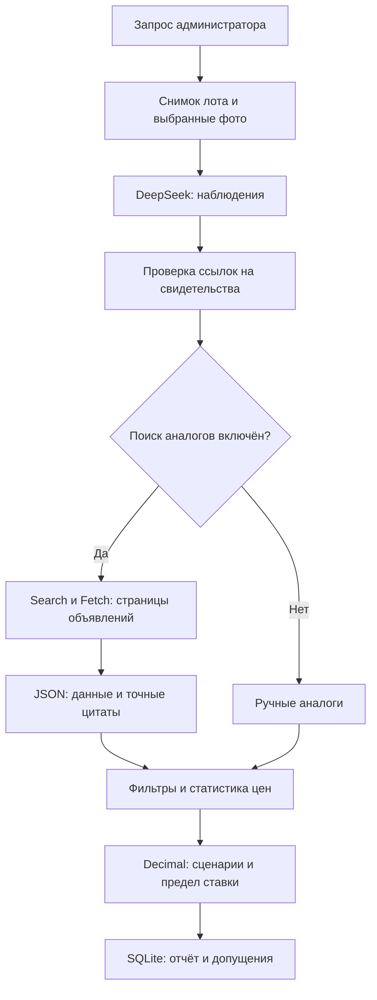

# Анализ автомобильного лота с DeepSeek

Модуль готовит проверяемые наблюдения и расчёт по одному лоту. Это прототип поддержки решения, а не техническая экспертиза, прогноз торгов или автоматическое участие. Рабочий API-ключ не добавлен; живые запросы и точность модели требуют отдельной проверки после подключения. Существующий SMTP/IMAP-цикл запросов управляющим сохранён.

## Пользовательский сценарий

1. Войти администратором и открыть лот. Уточнить марку, модель, год, известные характеристики и плановую ставку. Если ставка не задана, используется текущая рублёвая цена лота; она не является прогнозом итоговой ставки.
2. Заполнить расходы. Неизвестное поле оставить пустым. Ноль означает сознательное исключение расхода. Минимальная, базовая и максимальная оценки ремонта задаются пользователем после осмотра или расчёта специалиста.
3. При необходимости добавить ручные аналоги. Нужны ссылки на отдельные объявления, полные цены, даты наблюдения и известные характеристики. Для диапазона цен требуется не менее трёх подходящих неповторяющихся наблюдений.
4. Для анализа фотографий выбрать снимки и подтвердить их принадлежность автомобилю. Подбор по VIN сам по себе не доказывает принадлежность.
5. Подтвердить передачу описания, сведений об автомобиле, вопроса и выбранных фото в DeepSeek. Произвольные ФИО и чувствительные сведения в тексте могут не распознаваться автоматической очисткой; проверить описание и снимки перед передачей.
6. Запустить анализ. Состояние выполнения, отчёт и история сохраняются. При ошибке старый успешный отчёт остаётся доступен. Изменение описания, ответа управляющего, цены или выбранных файлов отмечает сохранённый отчёт как устаревший.

Без ключа работают ввод допущений и кнопка «Рассчитать без API». Такой расчёт не делает внешних запросов и не добавляется в историю AI-запусков.

## Архитектура



| Модуль | Ответственность |
| --- | --- |
| `schemas.py` | Ограниченные Pydantic-контракты входов и результатов; неизвестные значения не подменяются нулями |
| `settings.py`, `provider.py` | Серверные настройки, фиксированный HTTPS API DeepSeek, структурированный JSON, таймауты и бюджет запросов |
| `evidence.py` | Минимальный снимок лота, очистка контактов, безопасное чтение выбранных локальных изображений, проверка цитат |
| `market.py` | Разрешённые URL, поиск и загрузка страниц, проверка цен, подбор и статистика аналогов |
| `finance.py` | Денежные расчёты через Decimal; модель не считает прибыль и не выбирает расходы |
| `store.py` | SQLite-история, идентификаторы запросов, кеш, дневной лимит и один активный анализ |
| `service.py` | Фоновое выполнение этапов, обработка ошибок, сбор отчёта и отметка устаревших данных |
| `app/static/analysis.js` | Административная панель в карточке, ручной ввод, выбор фото, запуск и опрос статуса |

Получение письма обновляет обычную карточку прежним механизмом. Следующий анализ читает обновлённые сведения о состоянии. Автоматический LLM-анализ после каждого письма не запускается.

## Свидетельства о состоянии

Во внешний текстовый контекст входят только заголовок/описание, выбранные поля результата разбора ответа управляющего, сведения об автомобиле и вопрос. Не экспортируются полная строка SQLite, `raw`, почтовые реквизиты, оригинал письма, данные входа и весь документ `specs`. Из текста удаляются известные контакты/имена из полей лота, распространённые форматы телефона, email, идентификаторов и токенов. Это ограниченная очистка, а не гарантия обезличивания.

Выбранные фото должны принадлежать лоту в SQLite и иметь статус `ok`. Допускаются только файлы внутри `data/photos`; проверяются разрешение, размер и выход пути за каталог. Изображение уменьшается до 1600 px, перекодируется в JPEG без EXIF. Текст на самом изображении автоматически не скрывается. В отчёте сохраняются ID и SHA-256 исходных файлов, но не base64-копии изображений.

Типы выводов:

- `reported_fact` — сообщение описания или управляющего; требуется точная цитата из доступного текстового свидетельства. Это не независимо установленный факт.
- `visible_observation` — наблюдение по выбранному фото.
- `inference` — явно обозначенное предположение с доступным свидетельством.

Неизвестный ID свидетельства, незавершённый JSON или отсутствующая цитата приводят к ошибке анализа. Проверка цитаты подтверждает её наличие в источнике, но не истинность сообщения и не качество вывода модели. Скрытые дефекты, исправность агрегатов и стоимость ремонта не подтверждаются фотографиями.

## Поиск цен и подбор аналогов

1. Запросы строятся из марки, модели и года, без адресов должника и контактных сведений. По умолчанию не более двух запросов.
2. Принимаются только HTTPS-ссылки на отдельные объявления `auto.ru`, `drom.ru`, `avito.ru` и их поддоменов. Каталоги, статьи, произвольные хосты, IP-адреса и URL с реквизитами исключаются. Tracking-параметры удаляются. Страницы запрашиваются через DeepSeek Fetch, не напрямую с локального сервера.
3. Модель извлекает полную рублёвую цену, марку, модель, год и короткие точные цитаты с ID страницы. Цены из поисковых фрагментов не используются. Код проверяет присутствие цитат и соответствие числа в цитате; цена «от», кредитный платёж, аванс и неподтверждённая цена исключаются.
4. По марке/модели требуется совпадение нормализованных значений; год — в диапазоне ±1 по умолчанию. Если заданы поколение, двигатель, КПП или кузов, требуется совпадение; неизвестная характеристика аналога не считается совпадением. Пробег — отклонение не больше max(30 000 км, 25% целевого). Регион отображается, но ценовая поправка по нему не вычисляется; учитывайте географию вручную и задавайте доставку.
5. Исключаются заведомо повреждённые машины, закрытые объявления, неполные цены и наблюдения старше 30 дней по умолчанию. Неизвестная актуальность/состояние отражаются в предупреждениях. Загрузка страницы сегодня не доказывает свежесть предложения.
6. Удаляются повторы URL, VIN и вероятные дубликаты по набору характеристик. Без VIN распознавание повторов приблизительное; разные предложения могут быть ошибочно объединены, а разные цены одного автомобиля — не объединены.
7. При ≥5 наблюдениях исключаются цены с отклонением от медианы больше max(25% медианы, 3×MAD). Исключения и причины видны в отчёте.
8. При ≥3 оставшихся наблюдениях показываются средняя, медиана и Q25–Q75 с линейной интерполяцией. При меньшем числе диапазон и прибыль не рассчитываются. Это описательная статистика объявлений, не доверительный интервал и не гарантированная ликвидная стоимость.

Ручные аналоги проходят те же фильтры, но имеют метку `user_entered`: страницы загрузчиком не проверены. Для защищённых или недоступных источников используйте разрешённые данные вручную. Капчи и ограничения сайтов не обходятся.

## Экономика

Все расходы задаются пользователем, ставки налогов и ремонта не выдумываются. Неизвестный обязательный расход блокирует соответствующий сценарий; цель по прибыли нужна только для расчёта предела ставки под эту цель.

| Сценарий | База цены предложения | Ремонт |
| --- | --- | --- |
| Осторожный | Q25 | Максимальная оценка |
| Базовый | Медиана | Базовая оценка |
| Оптимистичный | Q75 | Минимальная оценка |

Обозначения: `P` — цена предложения для сценария, `B` — плановая ставка; `d` — скидка при продаже, `s` — комиссия продажи, `b` — комиссия покупки в долях единицы. `F` — доставка + осмотр + фиксированные сборы + хранение за весь срок + прочие расходы + налоговый резерв + резерв рисков + ремонт. `h = годовая стоимость капитала (%) × срок владения (месяцы) / 1200`.

```text
Продажа после скидки   = P × (1 − d)
Выручка после комиссии = P × (1 − d) × (1 − s)
Затраты до капитала    = B × (1 + b) + F
Полные затраты         = (B × (1 + b) + F) × (1 + h)
Прибыль                = Выручка после комиссии − Полные затраты
ROI (%)                = Прибыль / Полные затраты × 100
Предел ставки для цели = ((Выручка после комиссии − Целевая прибыль) / (1 + h) − F) / (1 + b)
```

Денежные итоги округляются до копеек. Предел ставки округляется вниз; отрицательный предел показывается как недостижимость цели. Простые проценты условно начисляются на все расходы за весь срок — реальное расписание денежных потоков не моделируется. Возвратный задаток сам по себе не расход; потребность в ликвидности отдельно не рассчитывается.

`winning_probability.value = null`: проверенной истории конкурентов и ставок нет. Вместо процента сервис показывает условную экономику участия и предел цены. Положительная прибыль в модели не подтверждает возможность допуска, победы, перепродажи или отсутствие обременений.

## API и хранение

Все маршруты ниже требуют `X-Admin-Token` действующего администратора:

| Метод и путь | Назначение |
| --- | --- |
| `GET /api/ai/status` | Готовность провайдера, модель и лимиты; ключ не возвращается |
| `POST /api/lots/{id}/analysis/calculate` | Расчёт по `Inputs` и ручным аналогам; без внешних вызовов |
| `POST /api/lots/{id}/analysis` | Запуск `AnalysisRequest`, ответ 202 с ID задачи |
| `GET /api/lots/{id}/analysis` | Последняя задача, последний успешный отчёт и десять последних запусков |
| `GET /api/lots/{id}/analysis/runs/{run_id}` | Состояние конкретной задачи и отчёт |

Схемы тел доступны в `/api/docs`. `request_id` — уникальная строка 8–80 символов `[A-Za-z0-9_-]`. Повтор того же ID с теми же входами возвращает прежнюю задачу; с другими входами — 409. Одновременно активен только один платный анализ. Идентичный активный запрос объединяется с текущим; идентичный успешный результат используется из кеша 30 минут. Изменение снимка лота, выбранных файлов, допущений или настроек модели меняет отпечаток запроса.

Таблицы `lot_analysis_runs` и `lot_analysis_requests` создаются без удаления прежних данных. Сохраняются допущения, источники, цитаты, время, статусы и числовая статистика API, но не ключ и не исходные ответы ошибок провайдера. Последний успешный отчёт не удаляется при ошибке нового. Незавершённые задачи при перезапуске получают `interrupted`; скрытого автоматического повтора и оплаты нет. История хранится в локальной БД без автоматического удаления.

Рабочий режим — **один процесс** `python scripts/serve.py`. Не запускайте несколько uvicorn workers и не используйте перезагрузку сервера во время анализа: восстановление задач рассчитано на один экземпляр. Заголовок `X-Admin-Token` предпочтительнее унаследованного query-параметра `token`, попадающего в URL.

## Настройки и подключение позже

Пока ключа нет, оставить `DEEPSEEK_API_KEY=`. После получения добавить ключ в локальный `.env` на сервере или его secret storage, затем перезапустить приложение. В браузер ключ не вводится. `DEEPSEEK_ANALYSIS_MODEL=deepseek-flash` — модель с vision по документации, проверенной 27.10.2026; при изменении API проверить доступность и совместимость заново.

| Переменная | По умолчанию | Назначение |
| --- | --- | --- |
| `AI_ANALYSIS_MAX_PHOTOS` | 6 | Лимит выбранных фото (1–12) |
| `AI_ANALYSIS_MAX_QUERIES` | 2 | Поисковые запросы (1–3) |
| `AI_ANALYSIS_MAX_PAGES` | 6 | Попытки загрузки страниц, включая ошибки (1–10) |
| `AI_ANALYSIS_DAILY_LIMIT` | 20 | Новые задачи за сутки UTC, включая неудачные; не денежный лимит |
| `AI_ANALYSIS_CACHE_MINUTES` | 30 | Срок повторного использования успешного результата (1–120) |
| `AI_ANALYSIS_MAX_SECONDS` | 240 | Общий срок сетевых этапов (30–600 секунд) |
| `AI_ANALYSIS_MAX_TOKENS` | 4000 | Верхняя граница ответа каждого chat-запроса (512–8000) |

По умолчанию не более двух chat-запросов, двух поисковых запросов и шести попыток Fetch за анализ. Автоматических повторов нет. Лимит задач/запросов не равен точному бюджету в рублях; стоимость зависит от тарифа DeepSeek и объёма контекста. HTTP 401/402/403/429, сетевые ошибки, превышение ответа и незавершённый JSON обрабатываются без вывода ключа или исходного тела ошибки. Защищённые источники могут не вернуться даже с рабочим ключом.

Адаптер использует фиксированный `https://api.deepseek.com`, `/chat/completions`, `/v1/tools/search`, `/v1/tools/fetch`. JSON и vision проверяются по контрактам; свободный текст модели не запускает дополнительные инструменты или команды. Приложение не делает ставки и не отправляет письма от имени LLM.

Официальная документация: [Vision](https://api-docs.deepseek.com/guides/vision/), [Chat completion](https://api-docs.deepseek.com/api/create-chat-completion/), [Search](https://api-docs.deepseek.com/api/search/), [Fetch](https://api-docs.deepseek.com/api/fetch/).

## Проверка

```bash
python -m pip install -r requirements-dev.txt
python -m unittest discover -s tests -v
python -m compileall -q app scripts
node --check app/static/analysis.js
node --check app/static/app.js
```

Тесты изолируют SQLite во временном каталоге и отключают фоновые обращения. Они проверяют формулы, пропуски/границы значений, удаление повторов и выбросов, подтверждение цитат, защиту URL и путей фото, удаление EXIF, авторизацию, отсутствие ключа, ручной расчёт, кеш, лимиты, одновременные запросы, восстановление и сохранение старого отчёта. Реальные DeepSeek-запросы, точность наблюдений по фото и актуальность сайтов сюда не входят.

Необязательная проверка панели в DOM (нужны Node и локальная dev-зависимость jsdom):

```bash
npm install --no-save --package-lock=false jsdom
node tests/test_analysis_ui.cjs
```

Она проверяет сбор ручных допущений, экранирование результатов, подтверждение передачи данных и принадлежности фото, запуск/опрос задачи и отбрасывание запоздавших ответов после закрытия панели. Это не визуальная проверка в реальном браузере.

Перед первым живым запуском подключить ключ на сервере и проверить один лот с известным результатом, одну фотографию и несколько вручную проверенных объявлений. Сопоставить цены/цитаты с источниками, наблюдения с осмотром и расход API с кабинетом провайдера. SMTP/IMAP на этом шаге включать не требуется.
